<p align="center">
  
</p>

<h1 align="center">Pixel Familiars</h1>

<p align="center">Animated pixel companions for <strong>Codex</strong> and <strong>Claude Code</strong>.<br>See your AI's activity, context and quota through a living pixel world.</p>

<p align="center">
  <a href="#codex"></a>
  <a href="#claude-code"></a>
  <a href="LICENSE"></a>
</p>

Owned and maintained by **[PhucUSk20](https://github.com/PhucUSk20)**. Based on [Namenomeaning/pixel-pet](https://github.com/Namenomeaning/pixel-pet), with original authorship and MIT notices preserved.

<p align="center">
  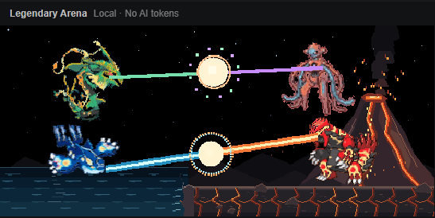
</p>

<p align="center"><a href="#legendary-companions">Meet the legendary companions and Arceus</a> · Autonomous roaming, meteorite transformations, two simultaneous battles, Palkia/Dialga rival encounters and rare Arceus visits.</p>

## Legendary pet GIFs

Click a GIF to open its full animation.

| Mega Rayquaza | Primal Groudon |
| --- | --- |
| <a href="docs/images/legendary-source-actions.gif">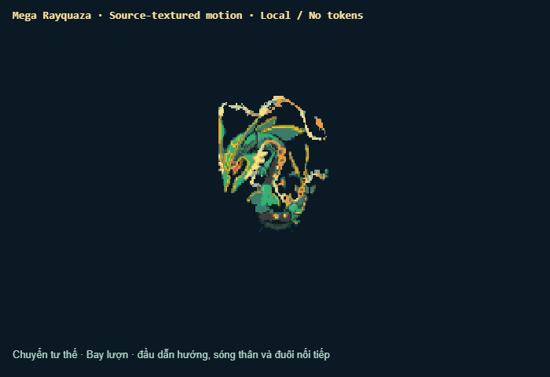</a> | <a href="docs/images/groudon-actions.gif">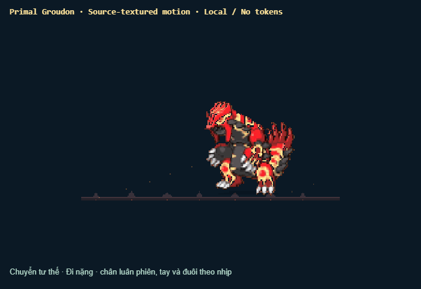</a> |
| **Primal Kyogre** | **Deoxys** |
| <a href="docs/images/kyogre-actions.gif">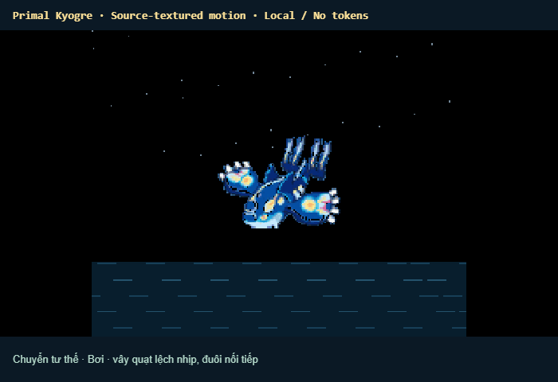</a> | <a href="docs/images/deoxys-actions.gif">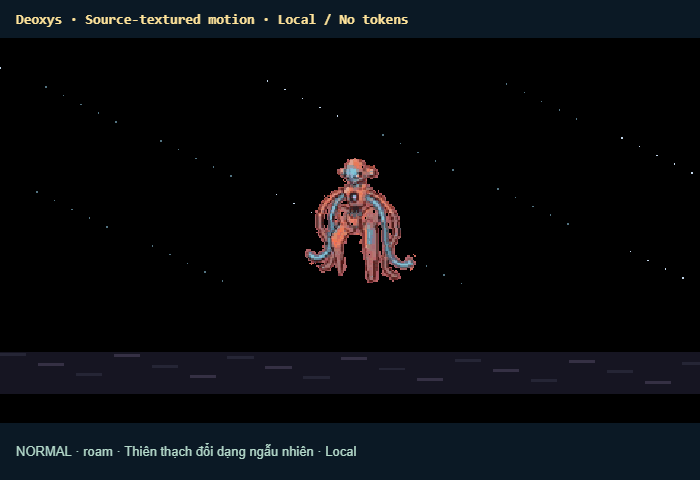</a> |

<p align="center"><a href="docs/images/creation-rivals.gif">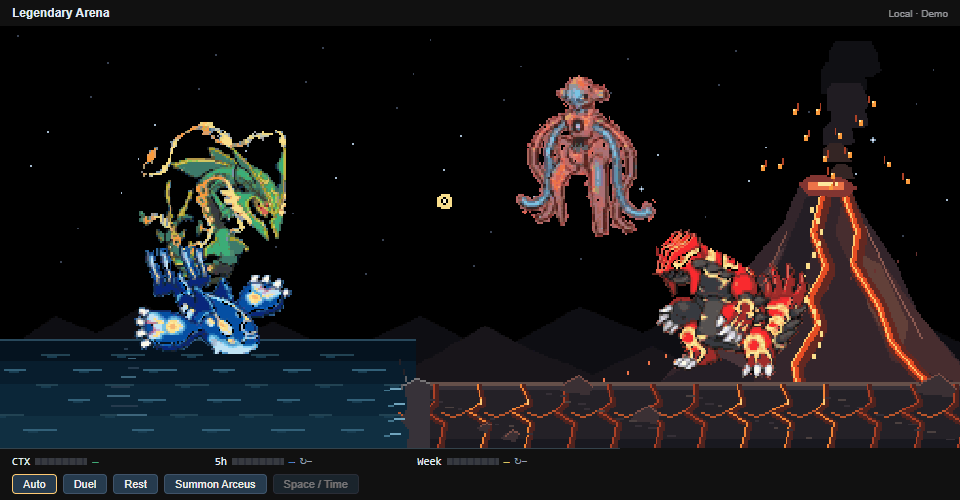</a><br><strong>Palkia &amp; Dialga</strong> — space-time portals, Spacial Rend / Roar of Time and optional Arceus intervention. <a href="docs/SPACE-TIME.md">Details</a></p>

<p align="center">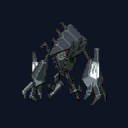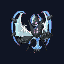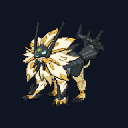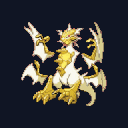<br>Necrozma ? Dawn Wings ? Dusk Mane ? Ultra</p>

<p align="center"><a href="docs/images/ultra-boss.gif">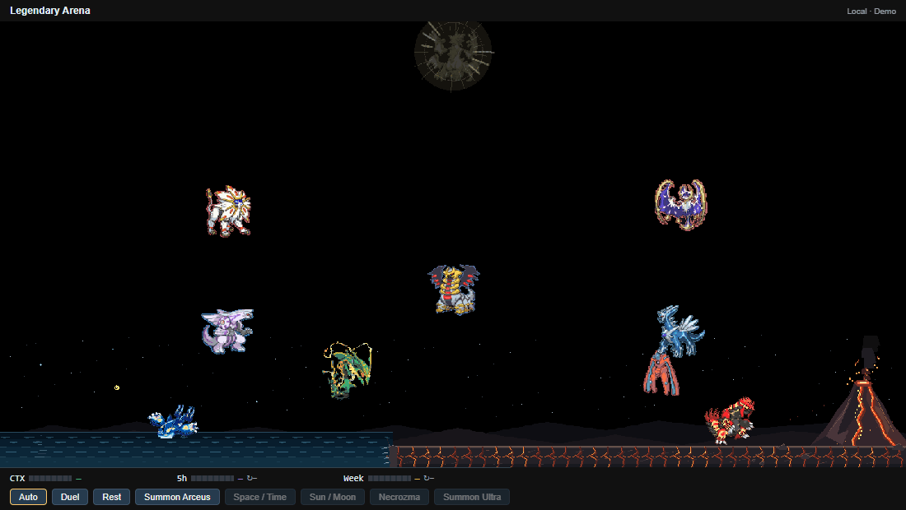</a><br><strong>Ultra boss battle</strong> - prism barrier, colossal light sphere and sky detonation.</p>
<p align="center"><a href="docs/images/ultra-arceus-war.gif">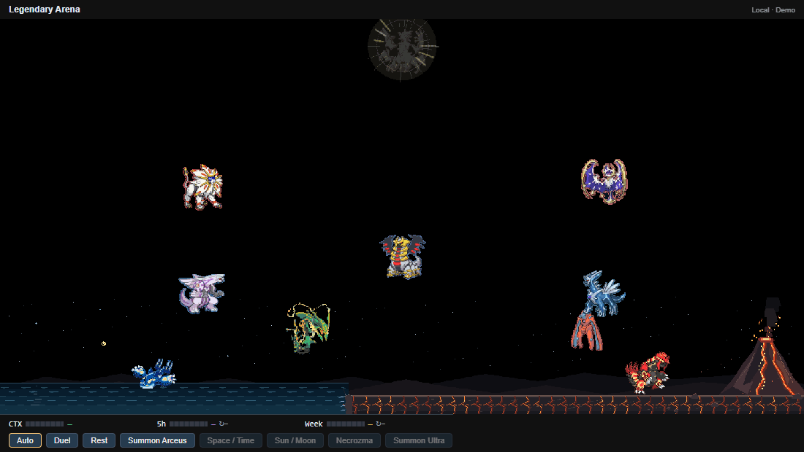</a><br><strong>Ultra &amp; Arceus</strong> - ten attackers, one Judgment counter. <a href="docs/NECROZMA.md">Details and controls</a></p>

<p align="center"><a href="docs/images/necrozma-restoration.gif">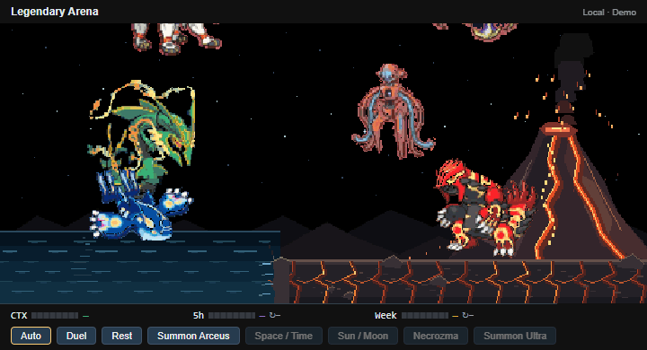</a><br><strong>Necrozma</strong> - Dawn Wings, Dusk Mane and Ultra light restoration. <a href="docs/NECROZMA.md">Scene and lore</a></p>

<p align="center"><a href="docs/images/arena-groups.png">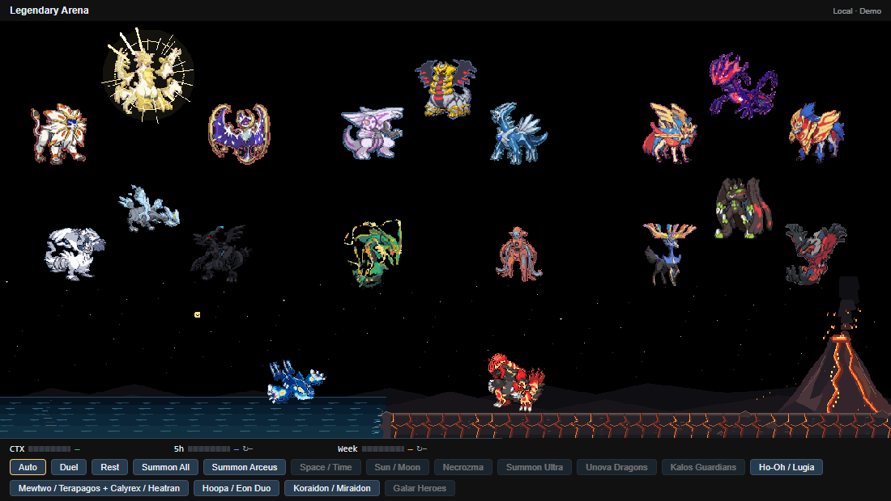</a><br><strong>Three-tier Arena groups (0.30.0)</strong> - <a href="docs/ARENA-LAYOUT.md">Current positions</a></p>

<p align="center"><a href="docs/images/galar-heroes.gif">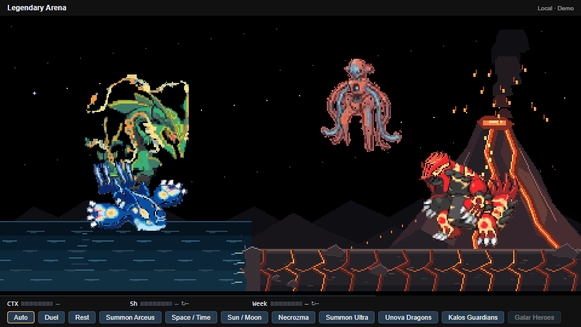</a><br><strong>Galar Heroes</strong> - <a href="docs/GALAR.md">Scene and controls</a></p>
<p align="center">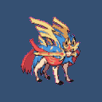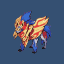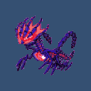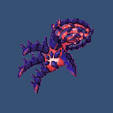</p>

<p align="center"><a href="docs/images/kalos-guardians.gif">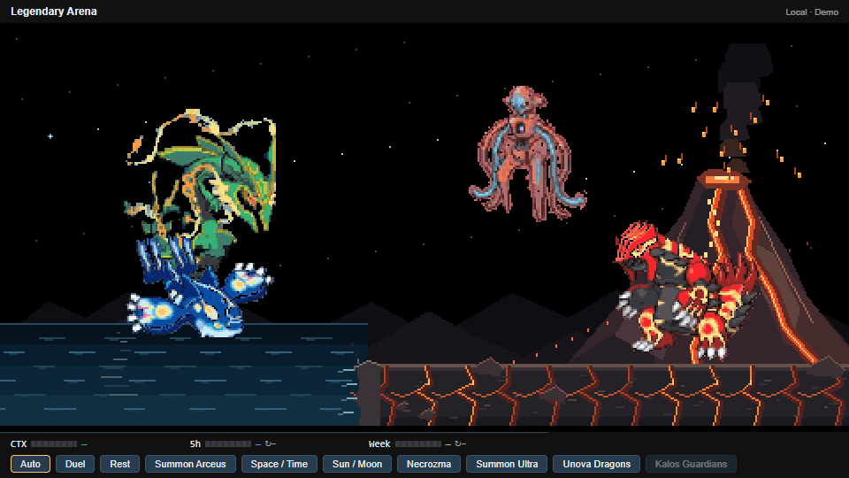</a><br><strong>Kalos Guardians</strong> - <a href="docs/KALOS.md">Scene and controls</a></p>
<p align="center">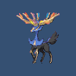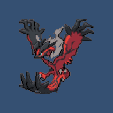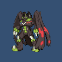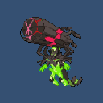</p>

<p align="center"><a href="docs/images/unova-white-fusion.gif">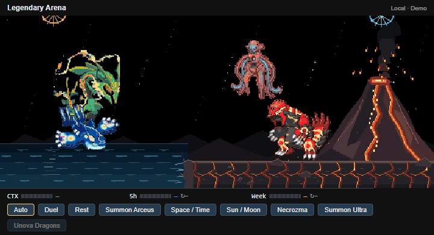</a><br><strong>Unova Dragons ? White Kyurem</strong> ? <a href="docs/UNOVA.md">Scene and controls</a></p>
<p align="center"><a href="docs/images/unova-black-fusion.gif">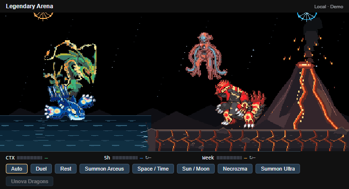</a><br><strong>Unova Dragons ? Black Kyurem</strong> ? each visit chooses White/Black with equal probability.</p>
<p align="center">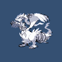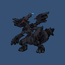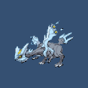<br>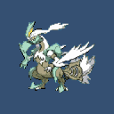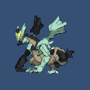</p>

<p align="center"><a href="docs/images/sun-moon-encounter.gif">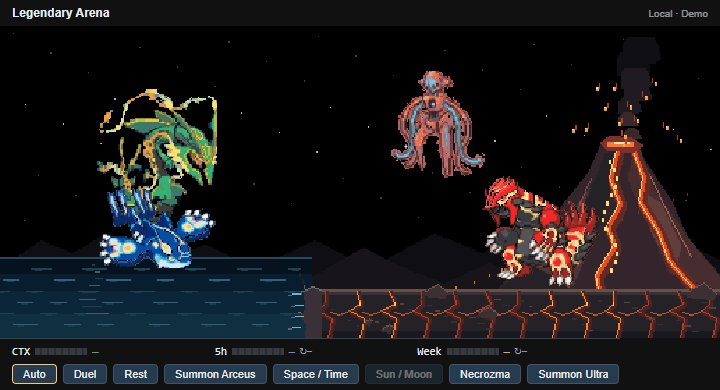</a><br><strong>Lunala &amp; Solgaleo</strong> - two friendly rounds, then departure. <a href="docs/SUN-MOON.md">Details</a></p>
<p align="center">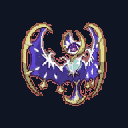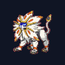</p>

<p align="center"><a href="docs/images/aerial-finale.gif">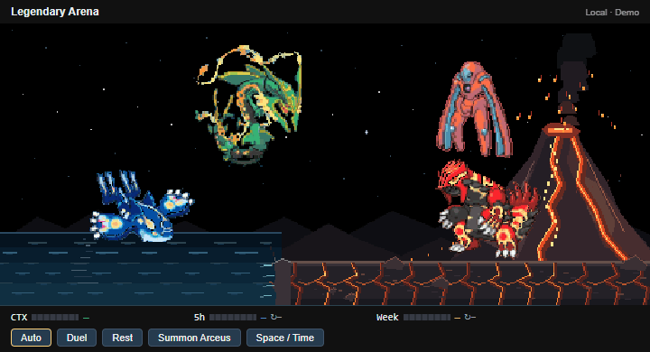</a><br><strong>Rayquaza &amp; Deoxys finale</strong> - tentacle frenzy, ultimate clash, shield destruction and meteor rebirth. <a href="docs/AERIAL-FINALE.md">Details</a></p>

<p align="center"><a href="docs/images/giratina-encounter.gif"></a><br><strong>Giratina</strong> ? shadow emergence, two sustained skill clashes and a violet shadow shield. <a href="docs/GIRATINA.md">Details</a></p>

<p align="center"><a href="docs/images/arceus-judgment.gif"></a><br><strong>Arceus</strong> — manual summons and rare descending visits, orbiting elemental tablets, an invulnerable barrier and Judgment counters. <a href="docs/ARCEUS.md">Details</a></p>

## Choose your companion

Both integrations use the shared pixel engine and theme format. Each connects to its own runtime; features differ where their event streams and display surfaces differ.

| | Codex | Claude Code |
| --- | --- | --- |
| Display | Responsive VS Code panel | Pet above the terminal prompt, HUD below |
| Activity | Native hooks, with a session-log fallback | Claude Code mod events |
| Shared pet motions | Read, search, write, terminal, web, think and celebrate | Read, search, write, terminal, web, think and celebrate |
| HUD | Context remaining and reported quota/reset times | Context remaining and reported quota/reset times |
| Customization | MCP theme tools, preview and import | Plugin skill, preview and theme tools |
| Task companions | Portal workers, subagent minis and automatic project Mini | Subagent minis following the main pet |
| Idle play | Independent roaming and 20 pet interactions | Breathing, looking around and sleep |
| Legendary Pets | Mega Rayquaza, Primal Groudon, Primal Kyogre, Deoxys, Palkia, Dialga, Giratina, visiting Arceus and shared Arena | Available through the Codex VS Code companion |
| Detailed guide | [Codex guide](docs/CODEX.md) | [Claude Code guide](docs/CLAUDE.md) |

Observation and animation run locally and add **no AI calls or tokens**. Asking an AI to redesign a theme uses its normal chat/tool workflow.

## Get started

Clone this repository to install the Codex companion or load the Claude plugin directly from source:

```bash
git clone https://github.com/PhucUSk20/pixel-familiars.git
cd pixel-familiars
```

### Codex

Requirements: Node **22.18+**, VS Code with the `code` command available, and the Codex extension installed.

Run one installation command from the cloned folder:

```powershell
npm.cmd run install:codex
```

On macOS/Linux, use `npm run install:codex`. The installer downloads dependencies, builds/packages the extension, installs it and configures the local observer hooks and MCP theme tools. In an interactive terminal, it opens the bundled Codex CLI for hook review:

1. Approve folder trust if prompted. Enter `/hooks`, review and trust the 12 **Pixel Pet observer** entries.
2. Exit the review CLI. Run **Developer: Reload Window**, then **Pixel Pet: Open Companion** in VS Code.
3. Start a new Codex conversation and run a tool. The panel should show **Direct hooks** after receiving a real event.

**Direct hooks** provides the fullest tool/subagent timing and compaction animations. **Log fallback** remains available when native events are unavailable; it cannot recover every nested start time. Review is required by Codex and is not granted automatically. The review CLI can close after approval. Noninteractive installations skip opening the CLI; use **Pixel Pet: Review Codex Hooks** in VS Code to review the observer entries manually.

<p align="center">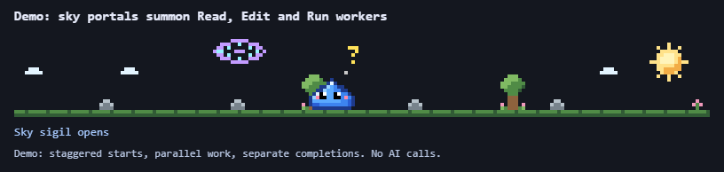</p>

Tools summon worker minis through colored sky portals. Parallel work keeps separate workers until recorded completion. Success brings a parcel back to the main pet; failure brings a clickable error sign. The persistent Mini watches observed checks and editor errors automatically.

The pets also explore independently and occasionally meet for **20 different idle interactions**. Feed invites a picnic, Play starts catch, and Rest pauses autonomous play. Real work interrupts play. The meadow fills the panel width, and short panels move the compact HUD into a corner. Workplace buildings are temporarily disabled.

<p align="center">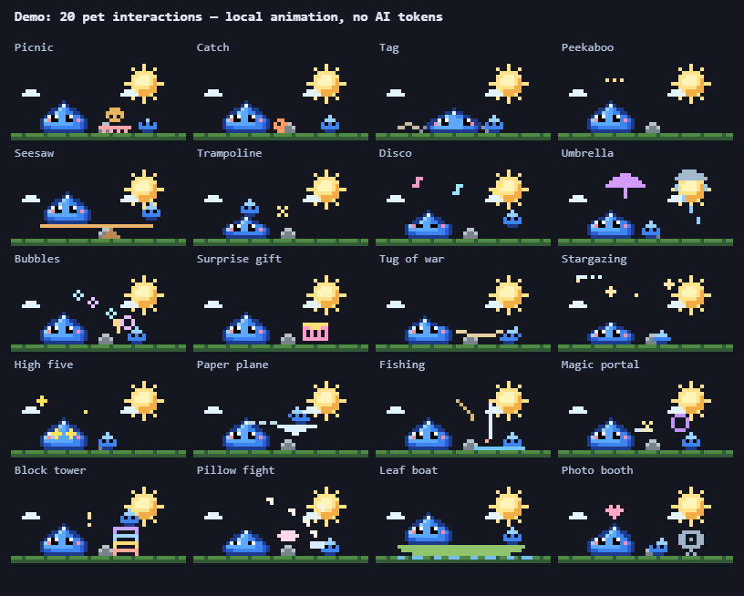</p>

The Codex GIFs use simulated activity with the production renderer. Update by rerunning the installer and reviewing changed hook definitions. Read the [Codex guide](docs/CODEX.md) for session selection, quota readings, settings, privacy and panel placement. The pet is a separate view rather than an embedded part of Codex's chat.

### Claude Code

Requirement: Claude Code **2.1.287+** (`claude --version`). Install the plugin from this repository's marketplace:

```bash
claude plugin marketplace add PhucUSk20/pixel-familiars
claude plugin install pixel-pet@pixel-pet
```

Start a new session, or run `/reload-plugins`. The pet appears above the terminal prompt with its context/quota HUD below.

The marketplace and plugin retain their established `pixel-pet` identifiers. If you already use the original marketplace, you can try this checkout for one session without changing that installation:

```bash
claude --plugin-dir ./plugins/pixel-pet
```

<p align="center"></p>

The pet acts out reading, searching, writing, terminal commands and web activity. Subagents get minis that remain until they finish. Tool failures change the pet's expression; completed turns make it cheer. Idle time brings breathing, blinking and sleep.

Run `/plugin configure pixel-pet@pixel-pet` for speed, sleep, HUD, status text and subagent minis. Ask Claude to customize a pet or run `/pixel-pet:pixel-pet`; review its browser preview before applying the theme. See the [Claude Code guide](docs/CLAUDE.md) for settings, updating, supported displays, privacy and development checks.

## Context and quota HUD

- **HP**: context window remaining.
- **MP**: remaining reported 5-hour quota, with a reset countdown.
- **ST**: remaining reported 7-day quota, with a reset countdown.

Quota availability depends on the runtime and account. Missing readings stay unknown. The bars reflect observed usage, not extra permissions or guaranteed task capacity. Low readings change colors and pet expressions.

## Make it yours

Both integrations support custom pixel pets, props, effects, status text, HUD colors and scenes through the shared [theme format](plugins/pixel-pet/skills/pixel-pet/FORMAT.md).

Try a purple slime, a rubber duck, a moon scene, a radar for web searches or a HUD named FUEL. **Codex** uses `get_theme`, `get_theme_format`, `preview_theme` and `set_theme`; **Claude Code** uses its plugin skill and theme tools. Preview the result before applying it.

<p align="center"></p>

## Legendary companions

Four resident source-textured pixel pets share **Legendary Arena**. Palkia and Dialga join as temporary visitors, either dueling each other or allied against Giratina, and **Arceus** occasionally appears at the center in Auto mode. Nearby pets step back gently; the residents, plus all present visitors, combine attacks against its invulnerable barrier before Arceus counters with Judgment. Use **Summon Arceus** for an immediate descending visit with orbiting elemental tablets. [Arceus actions and GIF](docs/ARCEUS.md). The four resident pets share the world in the Codex VS Code extension. They roam, choose activities and occasionally spar on their own. The world has a black starry sky, a rippling ocean, a flat basalt coast and an erupting volcano. Kyogre stays in the sea, Groudon walks on land, and Rayquaza and Deoxys fly overhead.

After installing the Codex companion and reloading VS Code, open the Command Palette and run **Pixel Familiars: Open Legendary Arena**. Use the following panel commands and Arena actions:

| Pet | Open or summon | Highlights |
| --- | --- | --- |
| **Mega Rayquaza** | `Pixel Pet: Open Legendary Pet` | Articulated flight, curled sleep, roar, Dragon Pulse, a fast dash with braking and Arena Dragon Ascent |
| **Primal Groudon** | `Pixel Pet: Open Primal Groudon` | Heavy walking, sleep, roar, magma blades, Energy Burst and diagonal meteor rain |
| **Primal Kyogre** | `Pixel Familiars: Open Primal Kyogre` | Swimming, diving, rest, roar, five-orb water jets, twin waterspouts and thunderstorms |
| **Deoxys** | `Pixel Familiars: Open Deoxys` | Flight, meteorite contact, Normal/Attack/Defense/Speed forms and distinct psychic skills |
| **Palkia** | Space / Time or rare Auto encounters | Spatial cracks, mouth pulse, articulated arm charge and Spacial Rend crescent |
| **Dialga** | Space / Time or rare Auto encounters | Gray time fracture, mouth flames, head charge and Roar of Time plasma |
| **Giratina** | Random Space / Time encounters | Ground shadow emergence, articulated wings, shadow lashes, twin-orb skill clashes and a dark violet shield |
| **Arceus** | Summon Arceus or rare Auto visits in Legendary Arena | Descending elemental orbit, blocked combined assault, Judgment counter and immediate departure |

All animation runs locally with **no additional AI calls or tokens**. Actions articulate the supplied sprites and blend between poses; individual panels also retain original-frame playback.

### Shared Legendary Arena

- **Auto**: independent roaming and activities, occasional battles and rare Arceus visits. Only nearby pets step back when Arceus arrives; landed Judgment volleys add slight knockback. Residents resume exploration after departure.
- **Duel**: Rayquaza fights Deoxys in the sky while Kyogre and Groudon exchange attacks below, with independent battle timing.
- **Space / Time**: summon a rival duel (55%) or Palkia and Dialga allied against Giratina (45%). After any visit without Giratina, the next visit guarantees it. Resident battles continue. Arceus has a 35% chance to intervene, triggering a synchronized combined assault and Judgment. [Encounter and GIF](docs/SPACE-TIME.md).
- **Summon Arceus**: immediate visit from any mode; switches to Auto and pauses battles. Arceus blocks the residents’ combined assault and counters with Judgment.
- **Rest**: all four resident pets settle down while their breathing animations continue; active Arceus and rival visits end.

The footer keeps **CTX**, **5h** and **Week** on one compact line: remaining context, remaining 5-hour quota and remaining weekly quota. Reset countdowns use a short label; hover for details. The values come from the same real Codex session selected by Pixel Pet, even when only Arena is open. Missing readings show **—**. The action buttons sit directly below the meters.

<p align="center"></p>

### Two simultaneous battles

**Rayquaza vs Deoxys:** Flamethrower meets Defense's barrier; Attack's Psycho Boost and Rayquaza's energy orb collide and explode; Speed combines an aerial pursuit with tentacle slashes; Normal trades a psychic pulse against Rayquaza's beam. The final round adds a cinematic Dragon Ascent / Psycho Boost finale: Rayquaza shatters Deoxys's energy orb and meteor shield, Deoxys dissolves, then a fallen meteor bursts and restores it. Between rounds, a meteorite stops in front of Deoxys at chest height; it touches the rock and changes form in 1.9 seconds without descending. [Finale GIF and details](docs/AERIAL-FINALE.md).

**Kyogre vs Groudon:** five jets launch from Kyogre's circular charging orbs; Groudon's magma blades erupt towards and beneath Kyogre; two waterspouts rise, merge and strike Groudon. Groudon also launches diagonal fireballs into a descending meteor shower, while Kyogre extends storm clouds over both pets and calls lightning down onto Groudon. Water and fire beams meet in a shared collision core. Hits add recoil, fragments, spray or steam.

<details>
<summary>Watch the full battle GIF</summary>

<p align="center">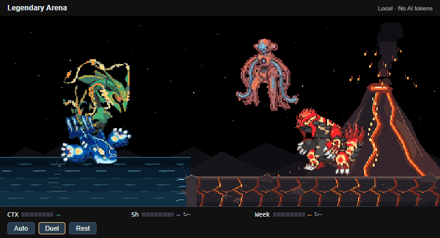</p>

</details>

### Mega Rayquaza

Five actions: **flight, curled sleep, roar, Dragon Pulse and dash/braking**. The body, head, jaw and flowing tendrils move through smooth transitions, including a sleeping pose that keeps the head visible.

<p align="center"></p>

### Primal Groudon

Six actions: **heavy walking, sleep, roar, Precipice Blades, Energy Burst and Eruption**. A glowing fracture advances towards the opponent before six jagged magma pillars erupt. Energy Burst charges at the mouth and launches with recoil; Eruption sends fireballs diagonally skyward before they descend over Kyogre. Arms, legs, head, jaw and tail articulate independently. [Groudon design and controls](docs/PRIMAL-GROUDON.md).

<p align="center"></p>

### Primal Kyogre

Seven actions: **swimming, diving, resting, roaring, five-orb water jets, twin waterspouts and a thunderstorm**. Its fins beat with a phase lag, and the head, jaw and tail follow the motion. Two spiraling waterspouts converge into a rotating water attack; contact with Groudon creates spray, steam and recoil. [Kyogre design and controls](docs/PRIMAL-KYOGRE.md).

<p align="center"></p>

### Deoxys

Deoxys flies freely until a meteorite falls nearby. It descends, touches the landed rock and transforms into **Attack**, **Defense** or **Speed**. Each form has its own skill: Normal's psychic pulse, Attack's large Psycho Boost sphere, Defense's layered barrier and Speed's rapid dodges with afterimages. [Deoxys forms, controls and animations](docs/DEOXYS.md).

<p align="center"></p>

<details>
<summary>Watch the meteorite landing and transformation</summary>

<p align="center">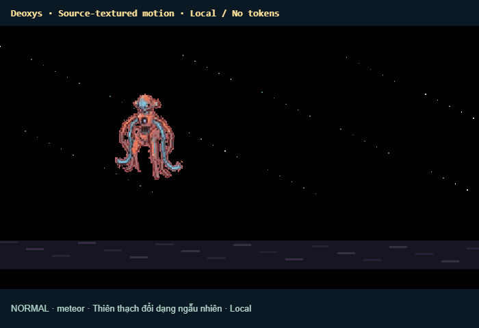</p>

</details>

## Develop

- **Shared engine and Claude adapter:** `plugins/pixel-pet/`.
- **Codex adapter and VS Code panels:** `extensions/codex/`.
- **Build, packaging and recordings:** `tools/codex/`.
- **Independent repo workflow and upstream contributions:** [development guide](docs/DEVELOPMENT.md).

For the Codex companion, run `npm.cmd ci`, `npm.cmd run typecheck`, `npm.cmd test` and `npm.cmd run package`. Also run `npm.cmd run test:ui` after host, renderer or bridge changes. On macOS/Linux, use `npm`.

For Claude plugin changes, follow [CLAUDE.md](CLAUDE.md) and run:

```bash
claude plugin validate . --strict
claude plugin validate plugins/pixel-pet --strict
claude plugin test plugins/pixel-pet
```

The [Claude Code guide](docs/CLAUDE.md#develop) includes generated-type setup and preview checks. Recreate Codex GIFs with `npm.cmd run record:codex-pets` or `npm.cmd run record:legendary` (Chrome/Edge and ffmpeg required).

## Privacy and security

The **Codex companion** observes local hooks, workspace-scoped session logs and project diagnostics. It retains sanitized activity metadata, not prompts, reasoning or full tool output. It does not modify OpenAI's installed extension or approve tools.

The **Claude plugin** runs inside Claude Code, reads its theme/session usage/subagent state and draws the pet. The mod makes no network requests, starts no processes and reads no environment variables. Its optional status targets show short file/command hints; turn those off when sharing your screen.

See each integration's guide for details. Report vulnerabilities through a [private security advisory](https://github.com/PhucUSk20/pixel-familiars/security/advisories/new).

## License and attribution

[MIT](LICENSE). Pixel Familiars is maintained by **[PhucUSk20](https://github.com/PhucUSk20)**. Original Pixel Pet by **halluqinate**, from [Namenomeaning/pixel-pet](https://github.com/Namenomeaning/pixel-pet). Original copyright notices and commit authorship are preserved.

**Ultra battle (0.26.0):** **Summon Ultra** starts a boss encounter with all present residents and visitors. A colossal light sphere feeds a wide sky pillar and full-arena shockwave. Space/Time/Giratina and Sun/Moon can coexist; when Arceus appears, Ultra switches to the joint assault, producing up to ten attackers before Judgment and a shared departure. Both summon orders can occur naturally. [Battle GIFs and controls](docs/NECROZMA.md).

**Necrozma (0.25.0):** summon an anime-inspired light-restoration scene with all four native forms. Lunala and Solgaleo are captured and freed in sequence, then provide light to restore Ultra; both remain visible before the transformation. Resident battles continue. [Demo GIF and lore](docs/NECROZMA.md).

**Galar Heroes (0.29.0):** Crowned Zacian and Zamazenta cooperate against Eternatus and Eternamax. Sword/shield defense, Dynamax Cannon and Eternabeam lead into a synchronized Behemoth Blade/Bash victory. [Demo and details](docs/GALAR.md).

**Kalos Guardians (0.28.0):** Xerneas and Yveltal clash rainbow and red-violet beams. Zygarde intervenes with Extreme Speed and Core Enforcer, evolves and ends the encounter with a purple hexagonal cannon. All three can join Arceus/Ultra battles. [Demo GIF and details](docs/KALOS.md).

**Unova Dragons (0.27.0):** summon Reshiram, Zekrom and Kyurem. Fire/electric clashes lead into homing missiles, a charged energy sphere and a random 50/50 White/Black fusion. The absorbed dragon returns before departure. The trio joins Arceus/Ultra battles and supports Rest cancellation. [Both Demo GIFs and details](docs/UNOVA.md).

**Sun / Moon (0.26.1):** spatial-cut arrivals, folded-wing lunar plasma and stationary lunar/solar beams with a moon near the top-right sky corner and a flaming sun near the top-left. Both visitor groups share the same 280px sky cap. Solgaleo occupies the left lane, raises its head and opens its star-shaped mane; Lunala occupies the right lane. Both can coexist with Space/Time/Giratina and join the combined attack against Arceus before Judgment and departure. [Encounter GIF and controls](docs/SUN-MOON.md).

**Ho-Oh / Lugia / Mewtwo (0.31.0):** [encounter details](docs/AVIAN.md), native sprites, sea emergence, coordinated attacks and random Mega X/Y. Summon All includes 23 actors with Mewtwo/Calyrex.

**Frequent Ho-Oh/Lugia visits (0.31.2):** the original four remain permanent; birds arrive with a rainbow/sea spray and visible wing beats, duel and depart. Each visit has a 25% Mewtwo chance. The existing frame stays unchanged. [Demo](docs/images/avian-birds-arrival.png).

**Mewtwo / Calyrex (0.32.0):** [duel details](docs/RIDER.md). Ice/Shadow alternation, freezing and Glacial Lance, ghost barrage, distinct Mega X/Y ultimates. Summon All brings Ultra, Mega Zygarde, Kyurem and Eternamax in from the start, with entrance effects; Arceus follows at 10 seconds.

**Stellar / Magma opponents (0.33.0):** Mewtwo now battles Terapagos between the middle/upper groups, while Calyrex battles Mega Heatran on the lower right. Rainbow crystal entrance and repeated Tera Starstorm, Earth Power cracks/eruption and Magma Storm tornado/lava pillars. Summon All includes 25 actors. [Encounter details and Demo images](docs/RIDER.md).

Arena 0.34.0 aligns Terapagos?Mewtwo?Rayquaza?Deoxys on the middle tier. Summon All skips the Ultra boss battle and waits for Arceus. Pets face Arceus until departure; selected legendary pets block Judgment with shields.

Arena 0.35.0 adds **Hoopa / Eon Duo** and **Koraidon / Miraidon** encounters, using five native animated pets, portal fists, mist/psychic volleys, Tera Blast, Flamethrower, Dragon Pulse and Electro Drift. Summon All includes 30 actors. [Details and Demo screenshots](docs/PORTAL-PARADOX.md).


Version 0.36 spaces Koraidon/Miraidon across the lower intermediate lane, lowers Ho-Oh beside Lugia, and fixes its rainbow to the arena floor.
