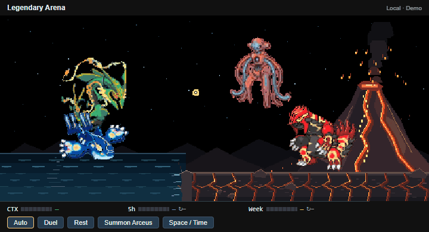

# Arceus

Open **Pixel Familiars: Open Legendary Arena** and use **Summon Arceus**, or wait for a rare Auto visit (150?300 seconds). Arceus descends with orbiting elemental tablets. Only nearby pets retreat; distant residents stay in place.

All present residents and visitors charge and fire simultaneously at its invulnerable barrier. Each plasma stream has two expanding white shock rings. Arceus counters with three Judgment volleys aimed at the pets? actual positions. Contact causes flashes, recoil and bounded knockback: up to 24 scene pixels per volley for unshielded pets and eight for shielded visitors.

Palkia and Dialga **both always raise shields** during Judgment. Giratina also joins the assault when present, making seven attackers. Its dark shield glows violet, intercepts Judgment at its surface and reduces recoil like the Space/Time barriers. Arceus and all temporary visitors depart immediately after Judgment finishes; Arceus no longer performs random follow-up skills. The visit lasts about 23.6 seconds. Residents resume roaming; Rest cancels the scene.

A standalone visit has a 40% chance to summon Space/Time visitors shortly afterwards. Their encounter independently selects the rival duel or Giratina alliance. All sprites retain native 128?128 source scale under the shared camera scale. Animation is local and uses no additional AI tokens. The GIF is a forced **Demo** visit.

References: [Judgment](https://tenor.com/view/pokemon-movie-pokemon-arceus-and-the-jewel-of-life-arceus-aruseusu-mythical-pokemon-gif-27629100), [elemental orbit](https://www.reddit.com/r/PowerScaling/comments/1jrtkbk/who_would_win_in_a_battle/).
