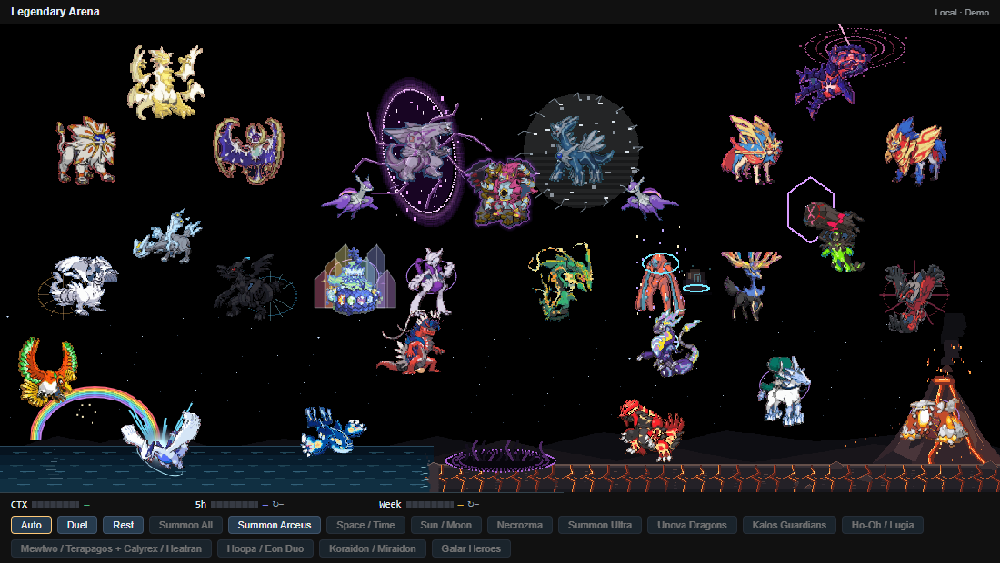

# Three-tier Arena groups — 0.33.0

Kyogre and Groudon stay on the lowest tier; Rayquaza and Deoxys occupy the middle center. Ultra faces right and renders at 1.1 times; Eternatus and Eternamax also render at 1.1 times with matching effect anchors.

| Tier | Left | Center | Right |
| --- | --- | --- | --- |
| Middle | Reshiram / Zekrom / Kyurem | Rayquaza / Deoxys | Xerneas / Yveltal / Zygarde |
| Upper | Solgaleo / Lunala / Necrozma | Palkia / Dialga / Giratina | Zacian / Zamazenta / Eternatus |

Each visitor group occupies a wider triangle within its own column, with two partners in front and the third member above their midpoint. The outer partners sit 8.5% from the left/right edges; spacing grows with the viewport instead of stopping at a fixed pixel cap. Solgaleo remains left of Lunala. Necrozma stays in its celestial group even as Ultra; Zygarde stays in the Kalos group when evolving. Galar heroes now approach their opponent from opposite sides.

The original four residents and frequent bird visits share the existing 160px sky: Ho-Oh lower at middle-left, Lugia in the ocean left of Kyogre. Terapagos, Mewtwo, Rayquaza and Deoxys share the middle tier in that order (34%/44%/56%/66% width, y=-120); Calyrex and Mega Heatran occupy the lower right; Kyogre and Groudon move closer together in the center. Their fights do not expand the sky. The other visitor encounters use the same fixed 360px sky extension to fit the three tiers. Adding another group does not add more height. Camera zoom preserves existing horizontal screen positions; viewport resizing remaps group centers proportionally. Arrival, rush, absorption and hit-recoil movements still occur within the choreography, with effects attached to the actual actor anchors.

Check the grouped scene with `node tools/codex/record-arena.mjs --layout --check --check-only`. Older cinematic GIFs document the skills; this image shows the current group positions.

**Summon All** starts a fresh full Arena encounter with 30 actors: every group, guaranteed Giratina, both birds, Mewtwo/Terapagos, Calyrex/Heatran, Hoopa/Eon Duo, Koraidon/Miraidon and Ultra Necrozma. Ultra, Mega Zygarde, base Kyurem, Eternamax and Mega Mewtwo enter immediately with the others; no actor waits for a later evolution to become visible. Each pet uses one current form, rather than duplicating every evolution. Native entrance effects run while the opponent pairs start their own battles. Ultra waits peacefully: Summon All never triggers the group assault or counterattack against Ultra. Arceus arrives at 10 seconds and becomes the common target. Repeat clicks are blocked; Rest cancels queued arrivals.

While Arceus remains visible, all pet bodies face its center. Their original directions are restored after it leaves, including during its departure animation. Rayquaza, Mewtwo, Kyurem, Zygarde, Eternatus and allied Ultra Necrozma raise colored barriers during Judgment. Meteor contacts land on the barrier crown; shielded recoil is eight pixels per volley rather than twenty-four. Existing Creation trio shields remain active.

[Hoopa/Eon Duo](PORTAL-PARADOX.md) occupies the gap between upper and middle tiers (50%/36%/64% centers, y=-225/-215/-215, 85% body scale). Koraidon/Miraidon occupy the lower intermediate lane (40%/68%, y=-35), between the middle and ground tiers. No extra height is added. Summon All includes all five new native animated actors.

Version 0.36: Koraidon/Miraidon occupy the intermediate lower lane at 40%/68% width, y=-35. Ho-Oh rests at y=0 beside Lugia; its departure descends. The seven-color rainbow is fixed at 9.5% arena width, y=158, with an unrotated 80?65 arch whose top is y=93. Bird movement, recoil and facing do not move this scenery or its spark region into the upper residents.
