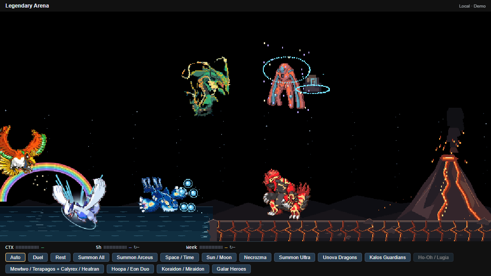
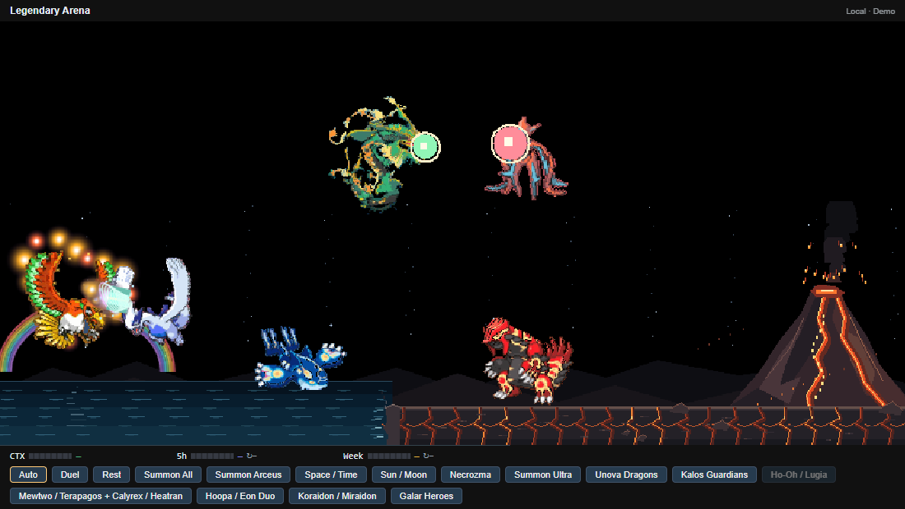

# Ho-Oh and Lugia ? 0.33.0

Arena keeps its original four permanent residents. In Auto, the birds first visit after about 12 seconds, then return 45?75 seconds after leaving. Ho-Oh arrives along a rainbow; Lugia rises from the sea with spray. Both use strong articulated wing beats and wander horizontally/vertically inside the existing 160-pixel sky. Rest cancels the visit and disables automatic appearances.

Each bird visit has a 25% chance of starting the independent Mewtwo/Terapagos and Calyrex/Heatran encounter. Ho-Oh and Lugia duel each other through ordinary and signature attacks, soar, then depart after 38 seconds. Ho-Oh sits lower at the left to avoid covering the tier above. See [Mewtwo and Calyrex](RIDER.md).

Ho-Oh periodically leaves a seven-color rainbow nearby. Sacred Fire surrounds its body with gold/orange flames before the fire breath. Lugia's ordinary Aeroblast charges at the mouth with converging light and fires a golden cone; its stronger attack retains a white/mint beam with traveling rings. The two birds share one collision point.

The group button uses the same optional-Mewtwo roll. Summon All guarantees both birds and the Mewtwo/Terapagos and Calyrex/Heatran pairs, starts every group with native entrance effects and its strongest selected forms, then brings Arceus at 10 seconds. Boss target lists include only present actors; their arrival preserves the Rayquaza/Deoxys battle.

References: [wing beats](https://64.media.tumblr.com/12c51b83b4ba5b9e6d0993fd9a147cb1/tumblr_mztzo08qX01s38aoyo1_500.gif), [Sacred Fire](https://pokemoninaction.tumblr.com/post/643201741514555392/ho-oh-used-sacred-fire-i-choose-you), [Aeroblast](https://makeagif.com/gif/lugia-aeroblast-Y2NWVv), [bird duel](https://makeagif.com/gif/pokemon-movie-15-ho-oh-vs-lugia-trailer-must-watch-EpAkeh).

Version 0.36: Koraidon/Miraidon occupy the intermediate lower lane at 40%/68% width, y=-35. Ho-Oh rests at y=0 beside Lugia; its departure descends. The seven-color rainbow is fixed at 9.5% arena width, y=158, with an unrotated 80?65 arch whose top is y=93. Bird movement, recoil and facing do not move this scenery or its spark region into the upper residents.
