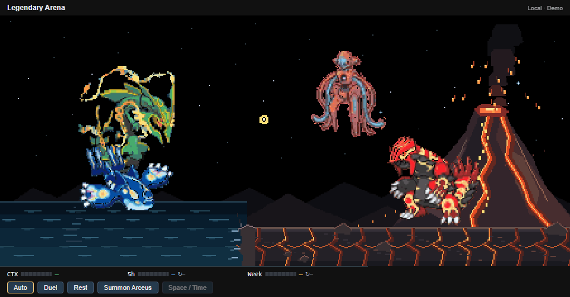

# Giratina

Version 0.22.2 adds Giratina to **Legendary Arena**. Use **Space / Time**, or wait for an Auto encounter. Each visit chooses one scenario: **55%** Palkia versus Dialga; **45%** Palkia and Dialga allied against Giratina.

Giratina rises from a dark ground rupture with red eyes and curling shadow tendrils. Its head, jaw, wings, legs and tail articulate using the supplied native 128px Altered Forme sprite. It spreads its wings while charging, opens its jaw and responds to hits. The additional sky uses a shared camera scale and preserves resident horizontal screen centers.

The allies attack Giratina in two rounds. Giratina retaliates with two shadow lashes, then gathers **two violet energy orbs** and sends one toward each rival?s incoming signature skill. Each 50px shadow orb stops behind its own pressure front and holds off Spacial Rend or Roar of Time. Compact violet plasma bands, a luminous rim, sparse sparks, short electrical arcs and one small shock ring build up at each contact before separate explosions release the pressure. Ordinary attacks likewise collide with its shadow lashes in mid-air. Recoil occurs when the collision explodes, rather than while attacks are being blocked. After the two signature collisions explode, two spatial cracks persist at their respective left/right pressure fronts, never at Giratina itself. A rival-only encounter retains the single central crack. Giratina sinks back into its ground rupture when leaving.

Rayquaza?Deoxys and Kyogre?Groudon continue their own battles throughout. A 35% post-signature roll can bring Arceus: all seven pets fire simultaneously into its invulnerable barrier. Palkia and Dialga both shield themselves from Judgment. Giratina keeps its gold, red and gray colors under a mild shadow tint. A violet aura follows its articulated body, wings, legs and tail, with no circular dome or dark fill. The aura appears during emergence, clears before charging attacks, and returns for Judgment. Judgment lands at the actual sprite crown, with contact sparks and reduced knockback (eight scene pixels per volley). All visitors depart after the counter, without extra Arceus actions.

The GIF is labeled **Demo** and forces the three-pet branch and subsequent Arceus intervention to show the shadow shield. Production retains random selection. Animation runs locally without model requests; unknown quotas remain unknown.

Visual references: [shadow emergence](https://i.pinimg.com/originals/f6/6b/14/f66b144de9630cf32b804672c5280c34.gif), [two-orb attack](https://uvn-brightspot.s3.amazonaws.com/assets/vixes/g/gifit_1478286456092-iloveimg-compressed.gif). The supplied source silhouette is retained; reference GIFs are not packaged.
