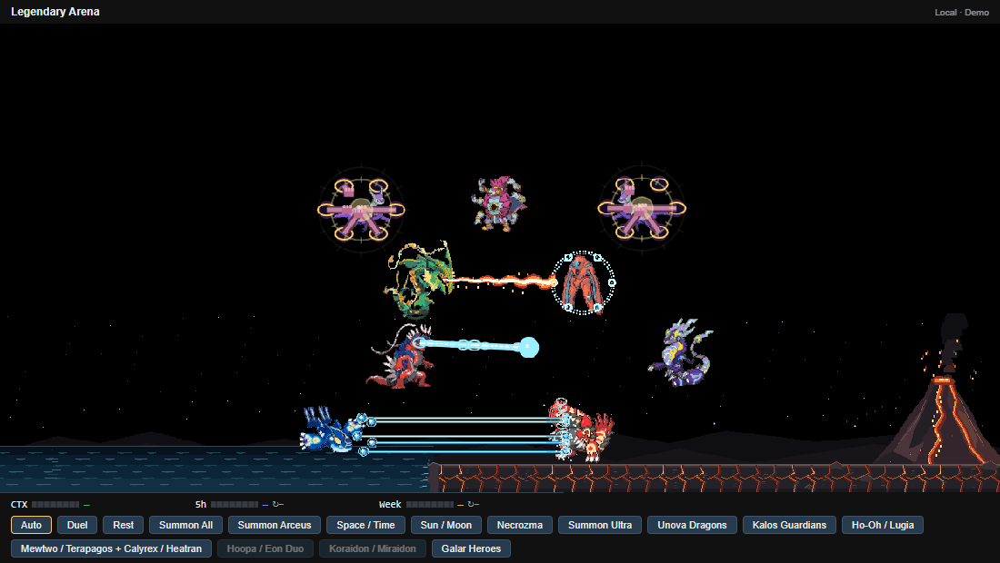
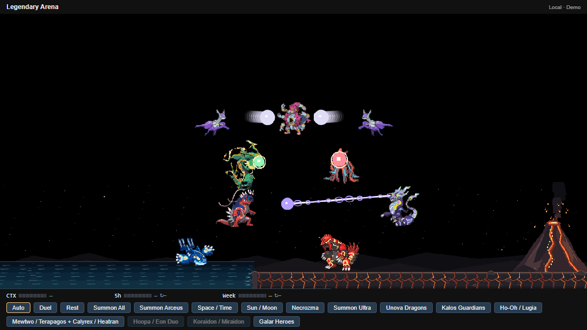
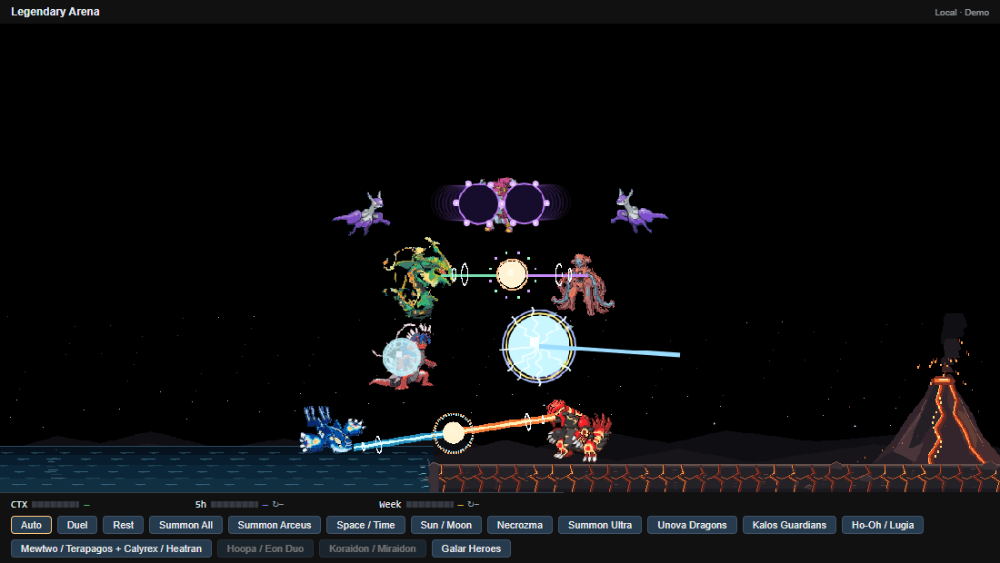
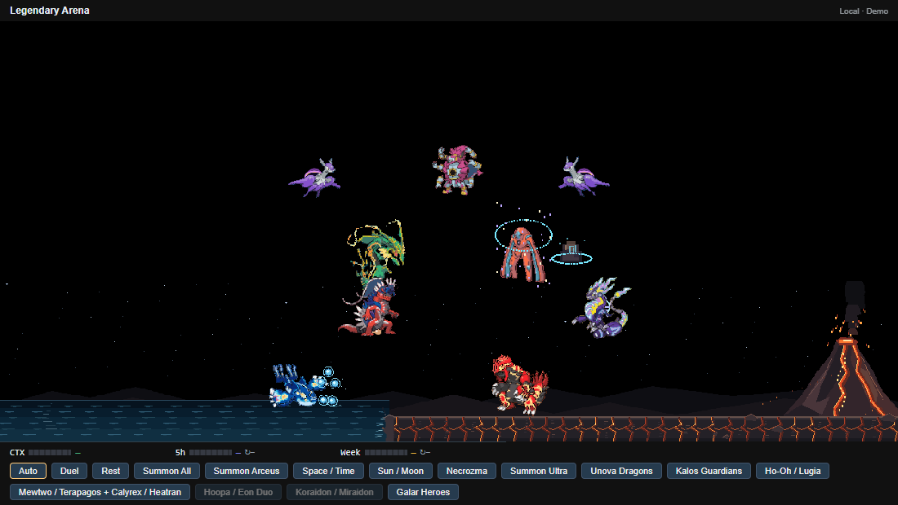
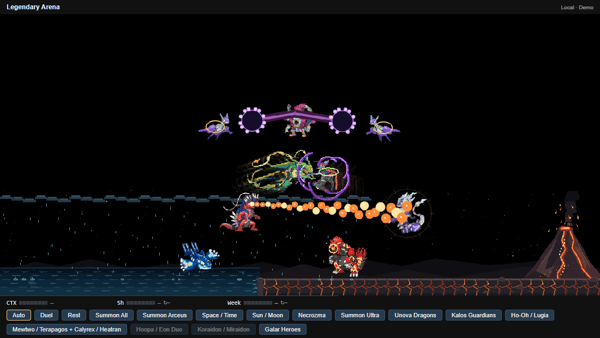

# Hoopa / Eon Duo and Koraidon / Miraidon - 0.35.0

Two independent encounters use the five supplied native 128px GIFs. Each atlas preserves all 160 frames and removes only the edge-connected RGB (53,80,114) background. Native wing, arm and body movement continues throughout the choreography; hit reactions and travel are applied around its stable center. These are custom local pixel effects inspired by the supplied references.

**Hoopa / Eon Duo** summons Hoopa Unbound between Mega Latias and Mega Latios. They occupy the gap between the upper and middle tiers: centers at 50%/36%/64% width, y=-225/-215/-215. The three bodies use 85% scale to fit the existing gap. Hoopa attacks both dragons, never making them attack one another.

Hoopa opens six gold portals around each opponent. An arm and fist extend from each portal toward the victim, strike in sequence and retract. The dragons reply with charged mist balls and swirling trails. Hoopa's ultimate gathers dark energy and fires two black-purple waves through gold rings at both opponents. The Eon duo ends with large dark psychic orbs, pink motes and a shared vortex burst against Hoopa.

**Koraidon / Miraidon** summons the rivals at 40%/68% width, y=-35, in the open band between the Mewtwo?Rayquaza tier and the Kyogre?Groudon tier. Koraidon charges a blue-white Tera Blast and later breathes a continuous expanding fire stream into Miraidon. Miraidon answers with Dragon Pulse, then charges a white-blue electric sphere, rushes into Koraidon with Electro Drift, returns to its original slot and leaves a lightning pillar at the hit location.

Each encounter lasts 42 seconds. Either button can be used separately; repeated summons are disabled. The four residents continue battling. All five actors enter Summon All immediately, increasing the full roster to 30; Ultra still waits peacefully for Arceus at 10 seconds. The new actors join the boss assault and Judgment target lists, face Arceus, hold during the boss encounter and leave with the other visitors. Rest cancels both scenes. The existing 160px/360px sky limits are unchanged. On narrow windows the action strip scrolls vertically so every button remains reachable.

Judgment spacing adapts to target count above 26, keeping all three volleys inside the existing twelve-second cast; projectile arrivals, contact flashes and recoil use the same timing.

References: [Hoopa portal punches](https://i.imgur.com/S5F2TdV.gif), [Hoopa dark attack](https://makeagif.com/gif/pokemon-unbound-hoopa-rekts-reshiram-and-zekrom-8bPcas), [Koraidon Flamethrower](https://tenor.com/view/battle-form-koriadon-pokemon-pokemon-koraidon-flamethrower-gif-17457675296035156128), [Miraidon Dragon Pulse](https://tenor.com/view/miraidon-pokemon-miraidon-pokemon-dragon-pulse-miraidon-uses-dragon-pulse-gif-3642361544314290), and the user's supplied mist-ball, psychic-vortex, Tera Blast and Electro Drift image sequences.

Verify with `node tools/codex/record-arena.mjs --portal-paradox --check --check-only` or the full `npm run test:ui` suite.
