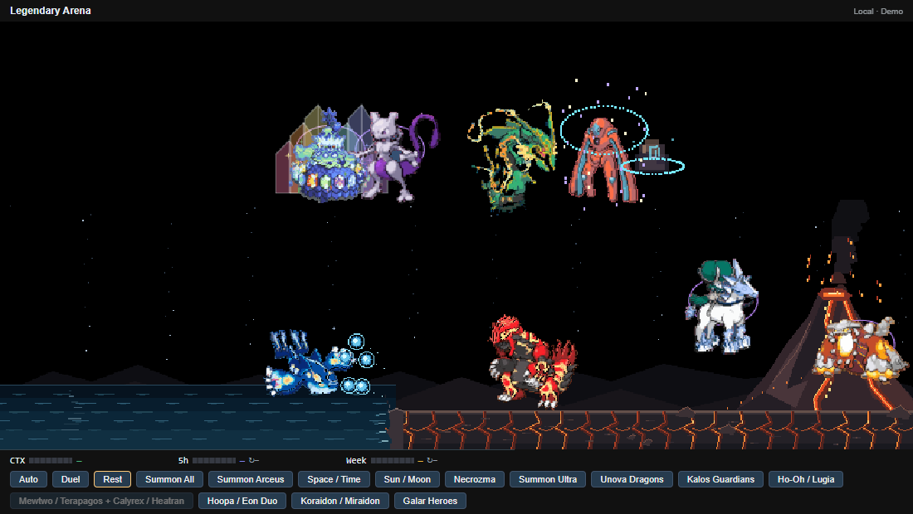
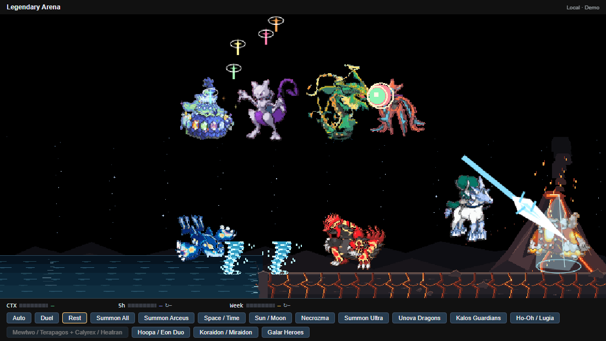
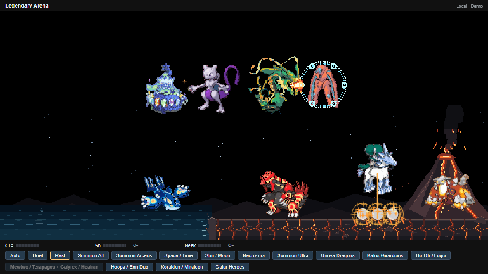
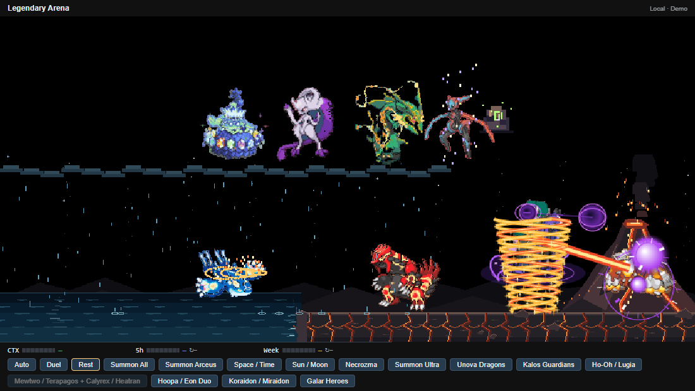
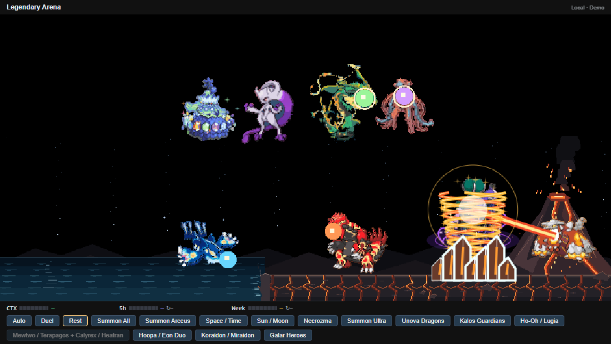

# Mewtwo / Terapagos and Calyrex / Mega Heatran ? 0.34.0

The encounter now has two independent opponent pairs: Mewtwo versus Stellar Terapagos, and alternating Ice/Shadow Calyrex versus Mega Heatran. Terapagos, Mewtwo, Rayquaza and Deoxys share the middle tier (y=-120), ordered left to right at 34%, 44%, 56% and 66% of the width. Mewtwo and Rayquaza stand between their opponents, with equal partner spacing and a wider gap between the two duels. Calyrex and Heatran occupy the lower right at 77%/92%. The scene uses the existing 160px/360px sky limits.

Terapagos enters inside seven-colored glass facets. Its native body floats with orbiting crystal glints and charge rings. Tera Starstorm gathers colorful stars, launches twelve staggered stars upward and sends them down onto Mewtwo, with impacts only after the descent.

Heatran's Earth Power cracks the ground beneath Calyrex and erupts with fire/debris. Magma Storm starts as lava breath, wraps Calyrex in a fire tornado, then explodes and raises seven lava-veined stone pillars from the ground. Calyrex retains its ice charge, frozen target, Glacial Lance/shatter, and Shadow ghost field with repeated Astral Barrage impacts; these now target Heatran.

Mewtwo retains the 50/50 Mega X/Y branch. Mega X lunges into a psychic hit and ends with a dark orb/blue-white impact. Mega Y charges before its body, arcs a dark orb above Terapagos, drops it into the target and creates a purple-white pillar with lightning/debris. The manual button starts the same 47-second choreography. Frequent bird visits retain a 25% chance of starting it; Ho-Oh and Lugia continue their own duel.

All four actors join boss target lists, leave after boss encounters, and cancel with Rest. Summon All includes both new native sprites immediately and totals 30 actors before Arceus with the Hoopa/Eon and Koraidon/Miraidon groups. Each pet has one current form, rather than duplicating alternate forms.

Motion reference: [Terapagos Stellar by mangalos810](https://www.deviantart.com/mangalos810/art/Terapagos-Stellar-1002737390), alongside the user's supplied Earth Power, Magma Storm, crystal arrival and Tera Starstorm image sequences. Runtime bodies use the supplied local GIFs. The matchup and Calyrex form alternation are custom Arena choreography.

Verify with `node tools/codex/record-arena.mjs --rider --check --check-only`.
